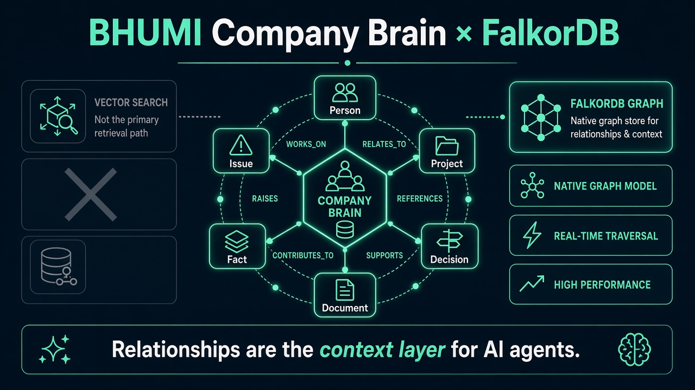
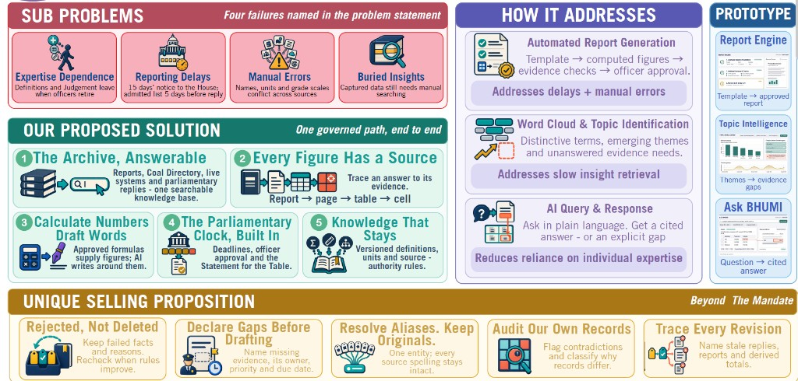
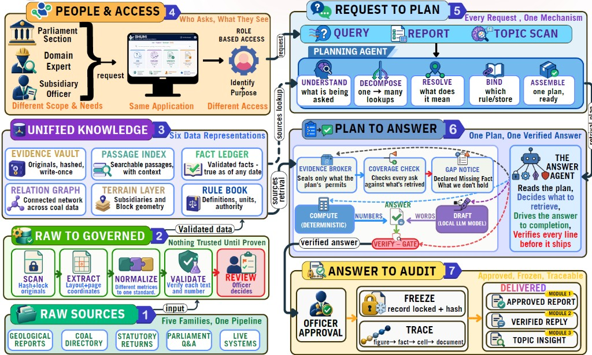
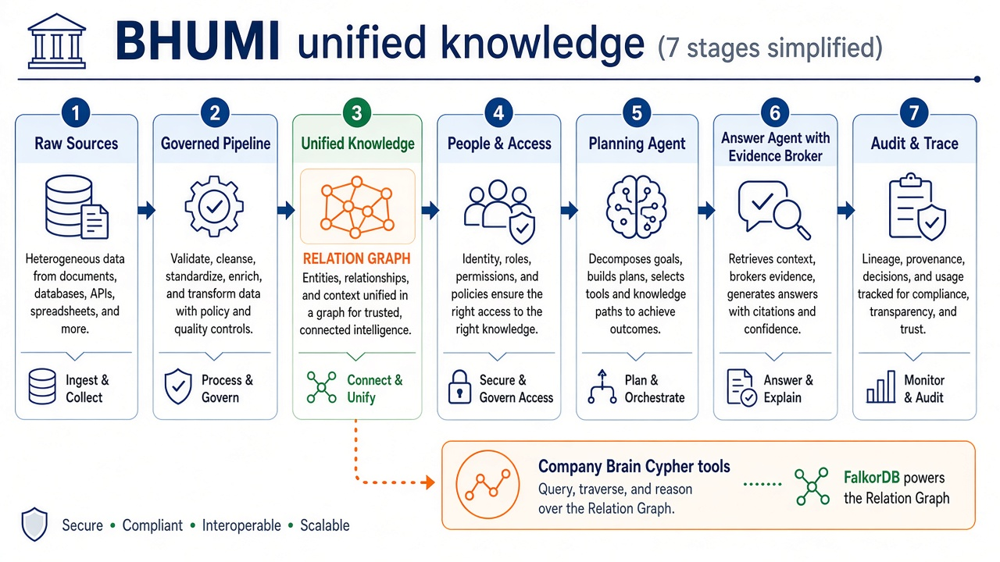
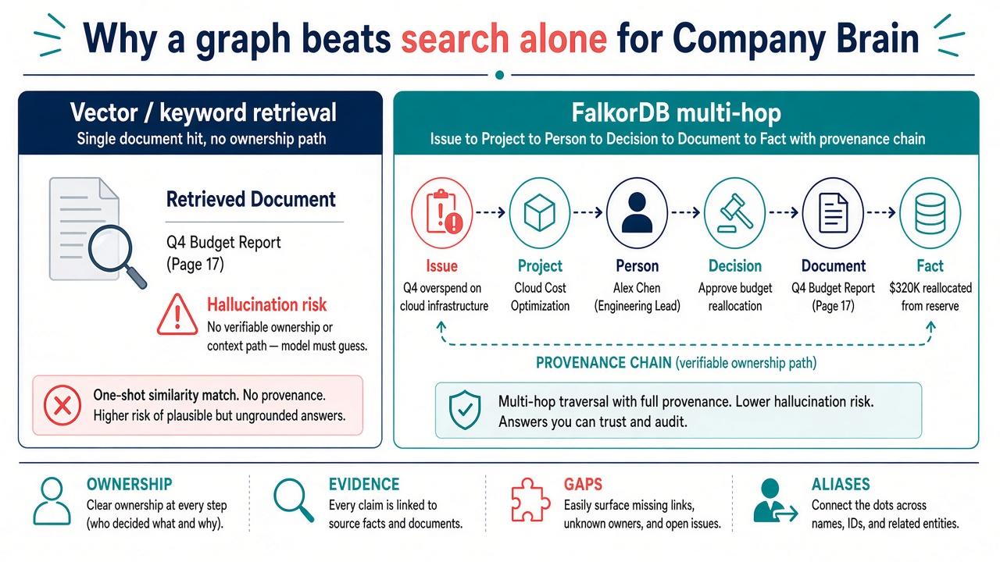
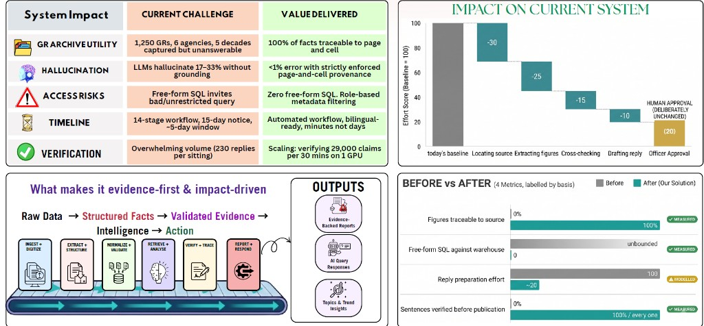
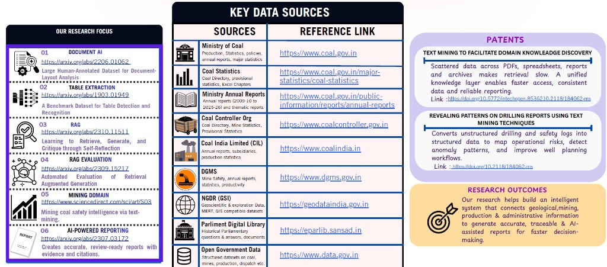

# BHUMI — Bharat Hub for Unified Mining Intelligence

**Company Brain × FalkorDB** · [Graph Hacks: Context for AI Agents](https://www.wemakedevs.org/hackathons/falkordb/rules)

| | |
| --- | --- |
| **Hackathon track** | Track 03 — Company Brain |
| **Repository** | [github.com/SYLESH-1125/FalkorDB_dynamite](https://github.com/SYLESH-1125/FalkorDB_dynamite) |
| **Graph database** | [FalkorDB](https://www.falkordb.com/) (`bhumi_company_brain`) |
| **Demo data** | Synthetic coal-ministry desk — no private or paywalled records |



---

## Problem (why BHUMI exists)

Coal-ministry and CIL-style desks sit on **decades of PDFs, directories, returns, parliamentary Q&A, and live systems**. The pain is not missing data — it is **missing connections**:

| Sub-problem | What breaks today | What BHUMI targets |
| --- | --- | --- |
| **Expertise dependence** | Officers retire; “who knew Jharia?” is lost | **People ↔ projects ↔ mines** in the graph |
| **Reporting delays** | 15-day parliamentary clock, 5-day drafting window | **Issue → owner → decision → source** in one hop |
| **Manual errors** | Names, units, and scales conflict across sources | **Facts with page refs**; **aliases kept, not merged** |
| **Buried insights** | Search finds text, not **accountability** | **Multi-hop Cypher**, not guessed LLM Cypher |

Original pitch deck (problem → solution → USP):



**Beyond the mandate (USP)** — each maps to graph behaviour in this repo:

- **Rejected, not deleted** → decisions and facts stay nodes; status on validations in Postgres.
- **Declare gaps before drafting** → `knowledge_gaps` Cypher + honest agent replies.
- **Resolve aliases, keep originals** → `ENTITY_ALIASES` / `alias` on nodes (e.g. Gevra vs Gevra OC Mine).
- **Audit our own records** → contradiction handling in query modules; graph shows conflicting `Fact` paths.
- **Trace every revision** → `Decision` → `BASED_ON` → `Document` → `Fact` → `EXTRACTED_FROM`.

---

## Vision: seven-stage architecture

BHUMI’s full vision runs from **raw sources** to **audited output**. Stage **3 — Unified knowledge** is where **FalkorDB** lives as the **Relation Graph**: the connective tissue between evidence, people, and commitments.



| Stage | Name | Role in this repository |
| --- | --- | --- |
| 1 | Raw sources | Upload / demo corpus (PDF, annexures, PQ logs) |
| 2 | Raw → governed | Ingest, extract, validate (Postgres + MinIO) |
| 3 | **Unified knowledge** | **FalkorDB graph** — people, issues, decisions, facts |
| 4 | People & access | JWT roles; scoped API |
| 5 | Request → plan | `brain_agent` **classifies** question → **named tool** |
| 6 | Plan → answer | **Validated Cypher only**; coverage + gap notices |
| 7 | Answer → audit | Path + sources in UI; record new `Decision` into graph |

Generated overview (FalkorDB highlighted at the knowledge layer):



```mermaid
flowchart LR
  subgraph sources [Sources]
    DOC[Documents]
    PQ[Parliamentary logs]
    SYS[Live desk data]
  end
  subgraph governed [Governed pipeline]
    ING[Ingest]
    VAL[Validate]
  end
  subgraph graph [FalkorDB Relation Graph]
    ISS[Issue]
    PRJ[Project]
    DEC[Decision]
    FAC[Fact]
  end
  subgraph agent [Company Brain agent]
    CLS[classify intent]
    TOL[bounded graph tools]
    ANS[answer + path + citations]
  end
  DOC --> ING --> VAL --> graph
  PQ --> ING
  CLS --> TOL --> graph
  TOL --> ANS
```

---

## Why FalkorDB (and why not “vector search alone”)

Vector search answers: *“Which chunk is similar to this question?”*  
A **company brain** must answer: *“**Who owns** this issue, **which decision** applies, **which document** supports it, and **which fact** on which page?”* — that is **path traversal**, not similarity.



| Capability | Vectors / keyword | FalkorDB Company Brain |
| --- | --- | --- |
| Project ownership | Not native | `OWNS`, `RESPONSIBLE_FOR`, `MEMBER_OF` |
| Decision defence | Hallucination risk | `Decision -[:BASED_ON]-> Document` |
| Evidence chain | One chunk | `Fact -[:EXTRACTED_FROM]-> Document` |
| Impact analysis | Manual | `DEPENDS_ON`, `AFFECTS`, `shortestPath` |
| Missing proof | Silent guess | `knowledge_gaps` + explicit gap text |
| Agent safety | Model-written Cypher | **Fixed tools** in `company_brain.py` |

If FalkorDB is down, `GET /health` reports `"graph":"down"` and `POST /api/brain/ask` returns **503**. There is **no** silent fallback to Neo4j, in-memory graphs, or hard-coded answers.

---

## What we built for Graph Hacks (Track 03)

**Company Brain** is a working slice of stage 3 + 5 + 6:

1. Natural-language question on **Company Brain** page.
2. Intent classification (`owns`, `issue`, `evidence`, `decision`, `impact`, `gaps`, `aliases`, …).
3. One or more **parameterized Cypher** queries from a fixed library.
4. UI shows **tool name**, **relationship path**, **sources**, and **query text**.
5. New **decisions** merge into the same graph for the next session.

**AI-assisted development:** Cursor was used for implementation speed; graph schema, Cypher, and tool boundaries are documented here for review and demo.

---

## Graph schema (`bhumi_company_brain`)

| Label | Meaning | Key properties |
| --- | --- | --- |
| `Organization` | Synthetic ministry desk root | `id`, `name` |
| `Subsidiary` | CIL-style subsidiary | `id`, `name`, `code` |
| `Person` | Officer / lead | `id`, `name`, `role` |
| `Team` | Owning unit | `id`, `name`, `mandate` |
| `Project` | Programme of work | `id`, `name`, `status` |
| `Mine` | Operating mine | `id`, `name`, `alias?` |
| `Document` | SOP, note, annexure, log | `id`, `name`, `kind` |
| `Decision` | Defensible choice | `id`, `title`, `summary`, `decidedOn` |
| `Fact` | Validated statement + provenance | `statement`, `confidence`, `pageRef`, `extractedAt` |
| `Topic` | Thematic tag | `id`, `name` |
| `Issue` | Open parliamentary / ops issue | `id`, `title`, `status` |
| `Ticket` / `Chat` | Desk workflow (impact queries) | `id`, `title`, … |
| `Memory` | Prior brain Q&A | `question`, `answer`, `askedAt` |

**Relationships (executable in product):**  
`HAS_SUBSIDIARY`, `MEMBER_OF`, `OWNS`, `RESPONSIBLE_FOR`, `KNOWS_ABOUT`, `WORKED_ON`, `AUTHORED`, `ABOUT`, `DECIDED_BY`, `BASED_ON`, `AFFECTS`, `DEPENDS_ON`, `BELONGS_TO`, `REFERENCES`, `MENTIONS`, `EXTRACTED_FROM`, `RAISED_BY`, `ASKED_BY`

Seed organisation is **fictional** and safe to publish.

---

## Cypher tools (real queries, not README-only)

Implemented in [`backend/cypher/company_brain.cypher`](backend/cypher/company_brain.cypher) and [`backend/app/infrastructure/graph/company_brain.py`](backend/app/infrastructure/graph/company_brain.py):

| Tool ID | Purpose |
| --- | --- |
| `owns` / ownership | Person / team owner + `RESPONSIBLE_FOR` |
| `issue_investigation` | Issue → project/subsidiary → person → decision → doc → fact |
| `evidence_from_project` | Decisions and facts supporting a project |
| `decision` trace | `BASED_ON`, `DECIDED_BY`, `AFFECTS` |
| `impact` | Dependents: projects, decisions, tickets, issues, docs |
| `related_projects` | Shared mines, teams, decisions |
| `knowledge_gaps` | Missing owner, decision, or facts |
| `entity_aliases` | Aliases and duplicate names (originals preserved) |
| `shortestPath` | Explainability between two entities |
| `upsert_fact` | Merge facts with `EXTRACTED_FROM` |
| PageRank / degree | Who is central on `KNOWS_ABOUT` (with fallback) |

**Try in the UI:**

- Who owns the **ECL offtake variance** issue and what **decision** supports the response?
- What **knowledge gaps** exist in the company graph?
- **Trace** the decision to adopt human-in-loop validation.
- What **breaks** if Gevra goes down?
- **List entity aliases** and duplicate names.

### Example investigation (multi-hop)

**Question:** Who owns the ECL offtake variance issue and what decision supports the response?

| Step | Relationship | Node |
| --- | --- | --- |
| 1 | `AFFECTS` | Issue → House Question Turnaround |
| 2 | `AFFECTS` | Issue → ECL (subsidiary) |
| 3 | `RESPONSIBLE_FOR` | Vikram Sethi → project |
| 4 | `AFFECTS` | Decision “Answer ECL offtake variance from validated PQ log only” → project |
| 5 | `BASED_ON` | Decision → Parliamentary Question Log |
| 6 | `EXTRACTED_FROM` | Fact “ECL offtake trailed plan…” → PQ log |

If step 4 were missing, the agent reports **missing decision evidence** — it does not invent a source.

---

## Impact (from product research)

Target outcomes for a production BHUMI desk (modelled where noted):



| Metric | Before | After (target) |
| --- | --- | --- |
| Figures traceable to source | 0% | **100%** (graph + pageRef on `Fact`) |
| Free-form SQL on warehouse | Unbounded risk | **0** — bounded graph tools |
| Reply preparation effort | 100 (baseline) | **~20** (human approval deliberate) |
| Sentences verified before publish | Ad hoc | **Path + sources** on every brain answer |

---

## Research & public data foundations

BHUMI’s roadmap aligns with document AI, RAG evaluation, and mining-domain text intelligence. **Public** sources intended for future ingestion (not scraped into this demo):



| Source | Use |
| --- | --- |
| [Ministry of Coal](https://www.coal.gov.in) | Policy, production statistics |
| [Coal Directory / statistics](https://www.coal.gov.in/major-statistics/coal-statistics) | Structured production context |
| [Coal India Ltd.](https://www.coalindia.in) | Subsidiary reporting |
| [DGMS](https://www.dgms.gov.in) | Safety intelligence |
| [Parliament digital library](https://eparlib.sansad.in) | PQ lineage |
| [data.gov.in](https://www.data.gov.in) | Open mining datasets |

**This hackathon build** uses a **synthetic graph** so judges can reproduce every hop without credentials.

---

## System architecture (deploy)

| Tier | Stack | Deploy |
| --- | --- | --- |
| Frontend | Next.js, TypeScript, Tailwind | Vercel |
| API + FalkorDB | FastAPI, `falkordb` Python client | Render (`Dockerfile.free`) |
| Relational / vectors | Postgres + pgvector | Supabase |

Local: Docker Compose — Postgres, MinIO, **FalkorDB**, API. FalkorDB Browser may use port `3000`; run Next.js on another port if needed.

---

## Quick start

**Prerequisites:** Docker, Node 20+.

```bash
cp .env.example .env
# JWT_SECRET — generate: python -c "import secrets; print(secrets.token_hex(32))"
docker compose up --build    # API http://localhost:8000

cd frontend && cp .env.example .env.local
# NEXT_PUBLIC_API_URL=http://localhost:8000
npm install && npm run dev   # http://localhost:3001 if 3000 is FalkorDB UI
```

`GET http://localhost:8000/health` → `{"status":"ok","graph":"falkordb"}`.

Sign in with `DEMO_ADMIN_*` from `.env`, open **Company Brain**.

---

## Tests

```bash
cd backend
pip install -r requirements.txt
export JWT_SECRET=dev-secret
export FALKORDB_HOST=localhost
pytest -q
```

Integration tests skip when FalkorDB is unreachable; `test_graph_unavailable_on_bad_host` asserts fail-closed behaviour.

**Last local run:** `1 passed, 5 skipped` (no Docker); full suite passes with `docker compose up falkordb`.

---

## Environment

- Root: [`.env.example`](.env.example)
- Backend: [`backend/.env.example`](backend/.env.example) — `FALKORDB_HOST`, `FALKORDB_GRAPH`, `JWT_SECRET`, `DATABASE_URL`
- Frontend: [`frontend/.env.example`](frontend/.env.example) — `NEXT_PUBLIC_API_URL`

---

## Demo video checklist

1. `/health` with `"graph":"falkordb"`.
2. ECL offtake issue question — show **tool**, **path**, **Cypher**.
3. Trace human-in-loop validation decision → Validation SOP.
4. Record a new decision; ask again.
5. Knowledge Graph explorer — person, decision, document.
6. Stop FalkorDB — `/api/brain/ask` returns 503.

**Demo video:** _[link when recorded]_

---

## Known limits & next steps

- Synthetic seed only; production would ingest governed facts from stage-2 pipeline into `upsert_fact`.
- Free Render tier: ephemeral graph — re-seed on boot; memories reset on restart.
- MCP exposure of graph tools is a future increment; REST + UI are the demo surface.

---

## Licence & attribution

Built for **WeMakeDevs × FalkorDB Graph Hacks 2026**.  
Author: **SYLESH-1125** ([sylesh1125@gmail.com](mailto:sylesh1125@gmail.com)).
